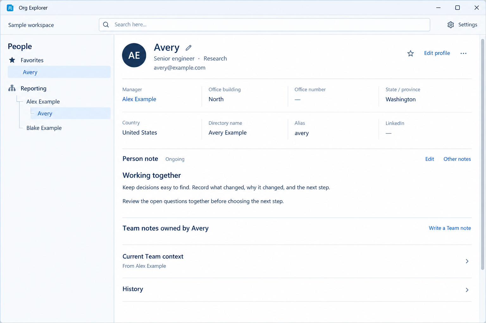
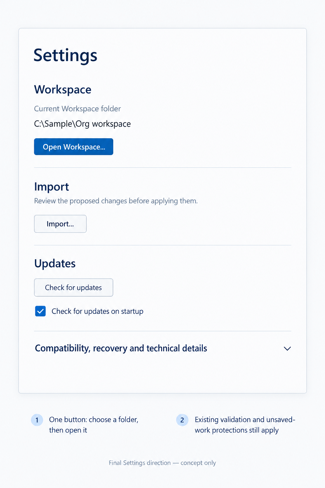
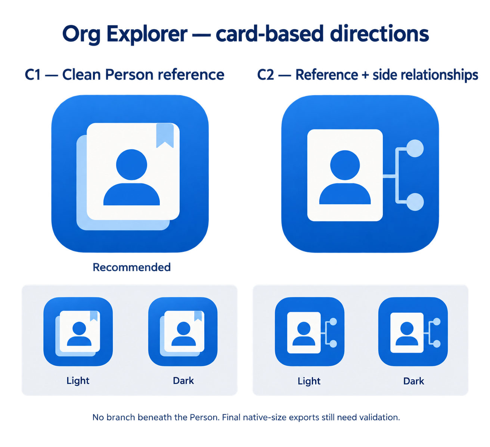

# Person workspace visual refresh

Status: all seven implementation slices (#71, #72, #76, #77, #73, #75 and #74)
are implemented together on the #70 integration branch, including integration
review corrections. Agreed and approved in the November 12, 2026 interview.
Final complete-candidate hosted functional/installer evidence and whole-pass
actual-WPF/reference owner review are still pending. Implementation is not
hosted or visual acceptance; no such acceptance is claimed.

## Purpose and precedence

The existing functionality and improved navigation are valuable, but the
rendered application remains substantially unlike the chosen calm, modern
Windows mockups. This pass must improve the actual appearance throughout the
application, not merely rearrange controls or pass functional tests.

Keep the original mockups' visual character, with freedom to improve their
composition. They are not mandatory pixel-for-pixel layouts. Continue native
Windows .NET/WPF as established by
[ADR 0005](adr/0005-native-windows-dotnet.md); do not introduce a web UI or
framework replacement.

This design supersedes the visual decisions in [ui-design.md](ui-design.md)
where they differ, specifically:

- Put facts above full-width notes in both wide and compact layouts, rather
  than putting a narrow profile column beside notes.
- Show all ordinary facts by default, rather than hiding populated fields
  behind More details.
- Save Preferred name explicitly rather than autosaving it during typing.
- Use one folder-picker-and-open action in Settings rather than an editable
  pending Workspace path with separate Choose folder and Open buttons.
- Keep identity visible while the facts and note reading content scroll.

The existing ongoing-note, exact-restoration, ownership, import, profile-draft,
external-change, history, and storage-safety contracts remain the baseline.
This plan does not complete or validate the separate, inherited source
integration currently staged in the preview worktree.

## Visual references and how to read them

All pictures are concepts using fictitious data, not screenshots of implemented
WPF or evidence that a layout works. Written decisions below take precedence
over incidental drawing errors. References showing alternatives approve only
the identified panel, not the entire comparison board.

The reading reference establishes hierarchy, compactness, facts-over-notes,
quiet chrome, and section alignment. Sample text, exact dimensions, icon
placement, and a drawn Favorite star's state are not substitutes for real
application state or accessibility behavior.

| Reference | Approved part and purpose |
|---|---|
| [Compact People](images/visual-refresh/compact-people.png) | Panel A: left trigger and left flyout. Its obscured facts are not a replacement for the fixed facts grid. |
| [Search destinations](images/visual-refresh/search.png) | Both states: reveal the matched field or the exact note in the real Person workspace. |
| [Settings](images/visual-refresh/settings.png) | Final grouped page with a displayed current path and one Open Workspace action. |
| [Profile editing](images/visual-refresh/profile-edit.png) | Panel A: inline form, not a dialog. Extra sidebar search, row icons, and country/state dropdowns are drawing artifacts, not requirements. |
| [Preferred name](images/visual-refresh/preferred-name.png) | Compact anchored editor and retained-input failure state. Outside-click cancellation follows the explicit decision below. |
| [Operational notices](images/visual-refresh/status.png) | Quiet normal state and concise global-problem notice. Incidental sidebar categories and depicted control enablement do not redefine navigation or safety. |
| [Scrolling](images/visual-refresh/scrolling.png) | Panel A: identity stays; facts and notes scroll together. The Workspace chevron is not approved. |
| [Paragraph measure](images/visual-refresh/note-measure.png) | Panel A: full-width section structure with bounded prose. |
| [App icon](images/visual-refresh/app-icon.png) | C1 only: clean Person-reference card. C2 and the previously rejected branch/monogram directions are not approved. |

These are not permission to add Groups/Organizations/department navigation,
a Workspace dropdown, a second search field, new profile attributes, or new
note-management features.

## Shared visual system

Use the chosen calm Modern Windows direction consistently, including Settings,
forms, errors, note controls, secondary context, and history:

- Readable Segoe UI typography, clear name/section/body hierarchy, and consistent
  rendered-Markdown typography. Do not shrink compact-mode text to make it fit.
- Near-white surfaces, restrained blue accents, subtle selection, light
  separators, and fewer heavy borders or generic boxed-control collections.
- Compact but comfortable spacing, aligned labels and actions, and purposeful
  whitespace rather than large empty placeholders.
- Consistent primary, secondary, icon, hover, keyboard-focus, disabled, and
  error states. An icon-only action still needs a meaningful accessible name.

This is not a request for a dense administrative form, decorative dashboard,
or a separate visual language for every control.

## Everyday toolbar

Use one compact row containing the quiet Workspace name, local search, and a
small gear-labelled Settings action. The Workspace name is non-interactive,
not a switcher or dropdown. Its full path belongs in Settings and remains
accessible for orientation.

Search has a magnifier, an empty-state hint such as "Search here...", and a
clear action when populated. Keep one search field, not a second one inside
People. Compact mode adds the People trigger on the left.

Remove permanent Ready/validated/saved rows and inactive Retry/Discard controls
from ordinary reading. Genuine activity, pending writing, stale data, errors,
available actions, and review warnings must still be understandable.

## Person identity and facts

### Compact, anchored identity

Use a flat identity band with a compact circular photo or initials placeholder,
the primary name and its Preferred-name pencil, role/department, email, and
right-side Favorite, Edit profile, and More actions. Do not retain oversized
rectangular missing-photo furniture, repeated name rows, or an empty
Preferred-name paragraph.

Preferred name and Directory name remain distinct; email remains the stable,
non-editable identity. Do not infer employment or presence. Ordinary
non-archived state needs no Active badge; an Archived Person must be explicitly
identified and retain existing access/reactivation safeguards.

Keep identity visible while reading farther down the Person. Long names,
emails, Manager labels, and values must remain readable or accessible without
shrinking type or requiring horizontal page scrolling.

### All ordinary facts, predictable positions

Below identity, use the available width for a labelled facts grid, with fewer
columns at narrower widths and multiple rows as needed. Its ordering and
column calculation depend on available width, not on which fields a Person
happens to have populated. Missing values retain their labelled slot with a
neutral dash; they are not validation errors or opportunities to repack fields.

Role, department, and email already shown in identity need not repeat in the
grid. Preserve the remaining ordinary facts: Manager, office building, office
number, office state/province, office country, Directory name, Alias, and
LinkedIn profile URL. Use consistent grouping/order across People. The
consolidated wide reference illustrates these eight slots in two rows.

Remove More details as a gate for ordinary facts. Keep full text and copy-value
access; links remain explicit actions and are never fetched/opened automatically.
Keep Manager and Imported-report navigation, including the distinction between
the Imported population and a complete company directory. History and provenance
remain secondary, not an extra permanent facts dump.

## Wide and compact composition

Wide mode has People beside one Person workspace. Facts sit above notes;
there is no independently sized profile-versus-notes column and therefore no
profile/notes divider. Preserve useful People-pane resizing and its remembered
wide balance. Existing stored preferences must not become invalid or lose
unrelated entries merely because an old inner-pane ratio is no longer used.

Compact mode retains the same field order and readable type, reduces facts
columns, and puts notes below them. The left People trigger opens a left-side
temporary overlay. It covers the Person viewport rather than shifting or
squeezing it. Never place the trigger and flyout on opposite sides.

Preserve accepted/rejected navigation behavior, overlay dismissal/focus return,
and in-session tree expansion/scroll restoration. A rejected destination must
not close the panel while silently replacing retained writing.

Keep the currently supported minimum, ordinary, wide, and boundary-size
behavior as the starting contract. Do not shrink the test matrix or supported
window to make the new composition appear usable.

## Reading, notes, and secondary evidence

Facts and note reading use one main content scroll beneath the anchored
identity. Remove fixed-height, independently scrolling note-reading boxes.
People/results and genuinely bounded editing/list surfaces may retain their
appropriate separate scrolling; this is not a requirement to expand every
multiline editor or large list to its full content height.

Note sections and their headings/actions span the Person pane, while paragraphs
have a comfortable reading measure rather than stretching across a maximized
window. Align prose with its section/title. Preserve Markdown rendering and
explicit external-link behavior.

Apply the same visual system to Person notes, owned Team notes, inherited
context, and historical reading. Empty sections get compact, purposeful writing
invitations, not tall blank editors and disabled action collections. Distinguish
true emptiness from unavailable writing, ambiguous ongoing selection, and a
retained failed draft.

Do not redesign the note model. Preserve existing Read/Edit, Other notes,
ongoing choice, exact document identity, independent autosave, title editing,
archive/restore, and retry/discard protections. Preserve attribution and review
warnings even when detailed context is collapsed. Inherited/frozen Team context
never becomes the selected Person's editable owned writing.

## People and search

People uses compact one-line names, modest indentation and guide lines,
subtle blue selection, and star-marked Favorites. Do not add a photo and
job-title subtitle to every tree row. Long/ambiguous labels must retain full
identity through accessible detail and existing navigation, not silently lose
People or reporting depth.

Keep live search across existing profile/note information and current,
archived, and historical distinctions. Search temporarily replaces Favorites
and the reporting tree; clearing it restores the prior browsing position.
Results show concise name, source, and relevant excerpt.

A profile result reveals the actual matched field in the Person workspace.
A note result opens the exact selected document in Read mode, retaining its
owner/current/frozen attribution and ongoing-versus-Other distinction. Remove
the duplicate generic Selected search context inspector; do not remove the
context-specific information needed to understand an inherited or frozen result.

Enter in the search field confirms the query/focuses results, not an implicit
first-Person selection. Explicit result selection followed by click/Enter
opens that result through the existing guarded navigation.

## Editing and keyboard behavior

### Full profile

Edit within the existing Person workspace, using a compact responsive labelled
form and clear Save profile/Cancel actions. Expose every editable field,
including empty fields, and retain photo and Manager editing. Ordinary text
attributes remain text; the concept drawing does not introduce new country or
state picklists.

This is one multi-field draft. Enter in an individual text field must not save
the whole form. Preserve explicit Save/Cancel, Save/Discard/Stay, stale-base
checks, Manager/history behavior, and independence from note/quick-action writing.

### Preferred name

The small pencil beside the primary name opens a compact single-purpose editor.
Save or Enter submits the value. Do not autosave while typing or on blur.
Only a successful save closes as a saved edit; failure retains input and shows
the error so Save can retry.

Cancel, Escape, **or clicking outside cancels this entry and closes the editor**.
Cancellation never saves the typed value and affects only this entry, not other
drafts or failures. Empty still clears Preferred name; existing invalid-input
and immutable-base/external-change protections remain.

Dismissal is not acknowledgment of a published storage conflict, proof that
nothing committed, or permission to clear another unresolved error.

### Enter is context-specific

| Context | Enter behavior |
|---|---|
| Preferred-name entry | Save that single-purpose entry. |
| Search field | Confirm/focus results; do not open the first Person. |
| Explicitly selected result | Open its exact guarded destination. |
| Full-profile text field | Do not submit the whole profile. |
| Multiline note editor | Insert a newline. |
| Import path | Preview import, with the same checks as Preview import. |
| Open Workspace action / native folder picker | Normal keyboard activation/selection; accepted folder proceeds immediately to the existing open operation. |

Do not introduce a global Enter handler that bypasses review, validation,
composition, native control behavior, or existing navigation/save protections.

## Settings and Workspace opening

Settings remains a bounded, scrollable in-app page, not another window or
flyout. Use clear Workspace, Import, and Updates groups. Keep rare compatibility,
recovery, and technical information/actions accessible behind a disclosure,
while active problems also remain visible outside it.

Display the current Workspace's full, copyable path. Provide exactly one
**Open Workspace...** action: open the folder picker, and when the user accepts
a folder, immediately attempt the existing validated Workspace-open operation.
Do not require a separate Choose folder step followed by another Open click.
There is no editable pending path field in this Settings design; the native
picker supplies folder entry/selection.

Cancelling the picker does not switch Workspace. Acceptance is not permission
to bypass retained writing, profile leave decisions, safe-update handoff,
compatibility refusal, or publication-conflict protections. A rejected open
must remain explicit and must not claim success or replace the successful
startup-folder preference with a failed choice. Preserve existing deliberate
manual opening/creation versus existing-only startup-reopen semantics.

Import still opens its dedicated preview/review workflow, and Apply reviewed
import remains a separate explicit action. Neither entering Settings nor
choosing a file applies an import. Keep update checks/startup preference and
the existing update-safety behavior; move lengthy technical explanations out
of the everyday reading path, not out of reach.

## Operational feedback and safety

Use concise summaries and scoped actions, with Details for technical material.
Global problems use an actionable notice beneath the toolbar; field-specific
failures stay beside their editor. Avoid duplicating one error in several
permanent panels, but never let a later unrelated success conceal an unresolved
failure or independent retained writing.

Keep pending saves, stale/unavailable data, unsafe close/restart, unavailable
restoration targets, import failures, review-needed context, and preference-write
errors conspicuous when relevant. Do not hide a blocking problem behind only a
small dot or a closed Settings disclosure.

Preserve the distinction between rejected unsaved writing, published conflicts,
indeterminate publication, and committed maintenance. Closing a visual panel,
generic discard, validation/maintenance retry, or restyling a status row must
not acknowledge external resolution, replay a committed operation, erase
retained evidence, or advertise safe close/restart prematurely.

## Application icon

Use **C1: the clean Person-reference card**: rich-blue rounded tile, white
portrait/reference card, blue Person glyph, a restrained bookmark detail and
subtle backing layer. It is an app identity, not a real person's photo.

Do not use the rejected abstract O/monogram or the Person with branching nodes
under its body, which read as stubby legs. The side-relationship C2 alternative
is also not selected.

Produce clean native icon assets from this direction, not a crop of the labelled
comparison board. Supply the actual Windows sizes needed by the executable,
window, taskbar, Start/shortcut, and applicable installer surfaces. Check the
real small-size appearance and both light/dark surroundings; simplify subordinate
detail at small sizes if needed while retaining the same recognizable mark.
The generated previews are not tested ICO exports. Do not add file associations
or change signing/update trust as part of branding.

## Implementation and review plan

Deliver one complete visual pass, then review it together. The owner explicitly
declined an early first-screen approval checkpoint. Internal implementation may
proceed in coherent increments:

1. Establish shared visual styles, everyday chrome, and the chosen app-icon assets.
2. Recompose identity, all-facts reading, People/search, and wide/compact scrolling.
3. Align inline editing, Preferred-name confirmation/dismissal, Settings opening,
   Import entry, and scoped operational feedback.
4. Align the existing note/context/history surfaces, then complete visual and
   functional evidence for the entire candidate.

These are work areas, not newly published tickets or permission to implement.
Do not introduce note-specific feature scope or an unrelated storage refactor.

At final review, show actual WPF views beside the relevant approved references,
not just generated pictures or a list of passing tests. Include:

- Wide and minimum/compact Person reading; long and missing values; archived
  identification; photo/placeholder; facts-before-notes and sticky-identity scroll.
- Wide/compact People overlay, hierarchy, search/clear, matched field and exact
  document navigation, with no shifted/squeezed background.
- Settings with one picker-and-open action, Import preview/explicit Apply,
  inline full-profile edit, and Preferred-name save/cancel/outside/failure states.
- Populated and empty note presentation, attributed current/frozen context,
  collapsed review warnings, genuine failures/retained drafts, and the actual
  installed/window/taskbar icon where applicable.

Review typography, spacing, hierarchy, controls, focus/hover, clipping/overflow,
scrolling, and visual consistency across the whole pass. Record deviations
explicitly and resolve them before visual acceptance; do not substitute a vague
"modernized" claim for comparison with the agreed direction.

## Evidence boundaries

Follow [docs/testing.md](testing.md). Use the lowest-cost existing observable
seam for the behavior: workflow/view-model for command and safety semantics,
real isolated folders for durability/nonmutation, and actual rendered WPF for
appearance, focus, layout, and binding behavior. Invisible compiled-control
checks cannot establish the visual result.

Adapt existing journeys for deliberate UI changes without weakening destination,
save, rejection, ownership, or recovery assertions. Do not add hidden Settings
repair, action retries, fake success/readiness flags, smaller populations, or
shorter acceptance matrices to make tests pass.

Keep all required core, filesystem, ordinary-desktop, and high-resolution lanes,
their named scenarios and deadlines, and the separate explicit scale selection.
Final evidence must identify the exact complete candidate. Earlier runs do not
validate a new visual tree; do not claim either complete 10,000-Person suite
unless it actually ran for the relevant candidate.

Desktop automation/capture follows the existing hosted or explicitly authorized
isolated-desktop boundary. Do not manipulate the user's real Workspace, shared
display settings, or ordinary desktop to manufacture acceptance evidence.

## Planning and delivery boundary

No application implementation, issue publication/closure, PR, main merge, or
approval of the inherited staged source integration is part of drafting this
design. No glossary or architectural model changes are required.

After document approval, follow the
[documentation handoff contract](agents/documentation-handoff.md): isolate these
approved Markdown/image changes, create a focused documentation-only commit,
push and verify its immutable source/base/content, and return the producer
handoff record. Keep it reachable and unmerged into the default branch until
delivery with its matching implementation. Establish integration ownership and
the receiving baseline before implementation; this source branch's code ancestry
is not itself a validated integration candidate.
